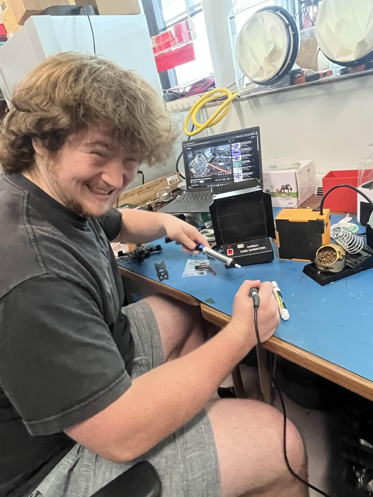
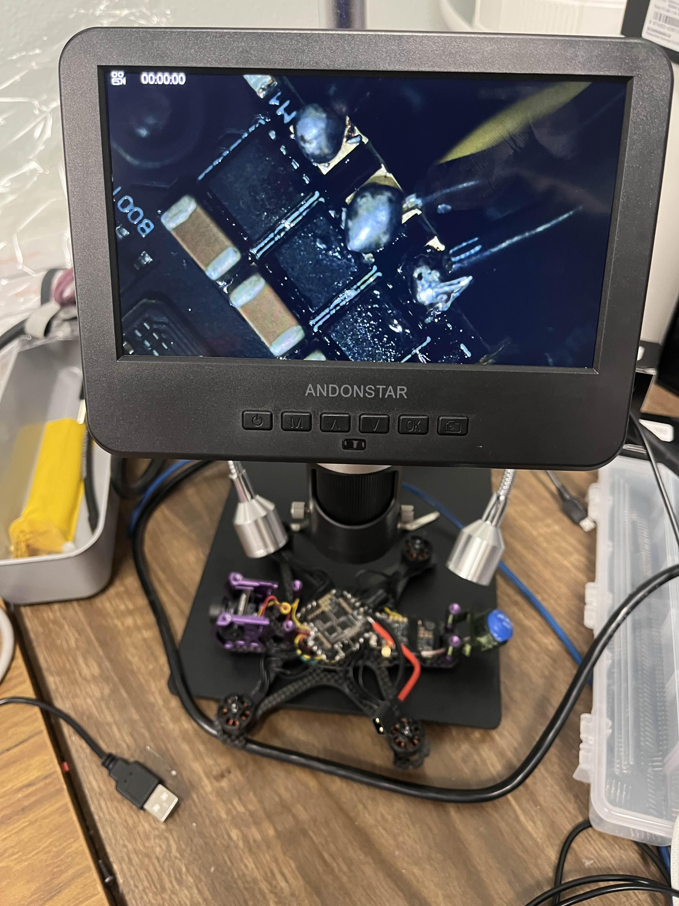
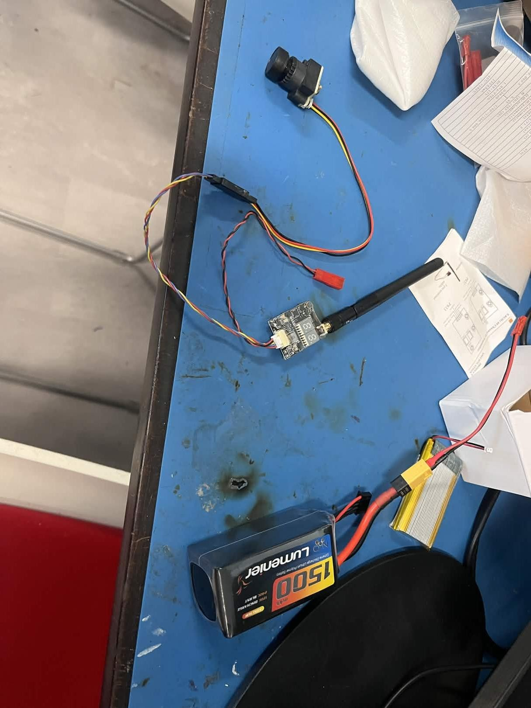
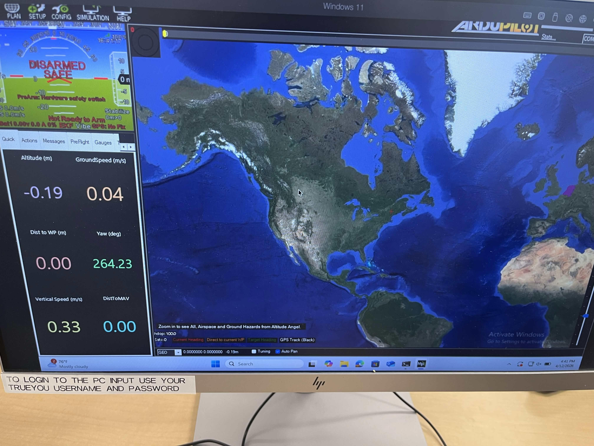
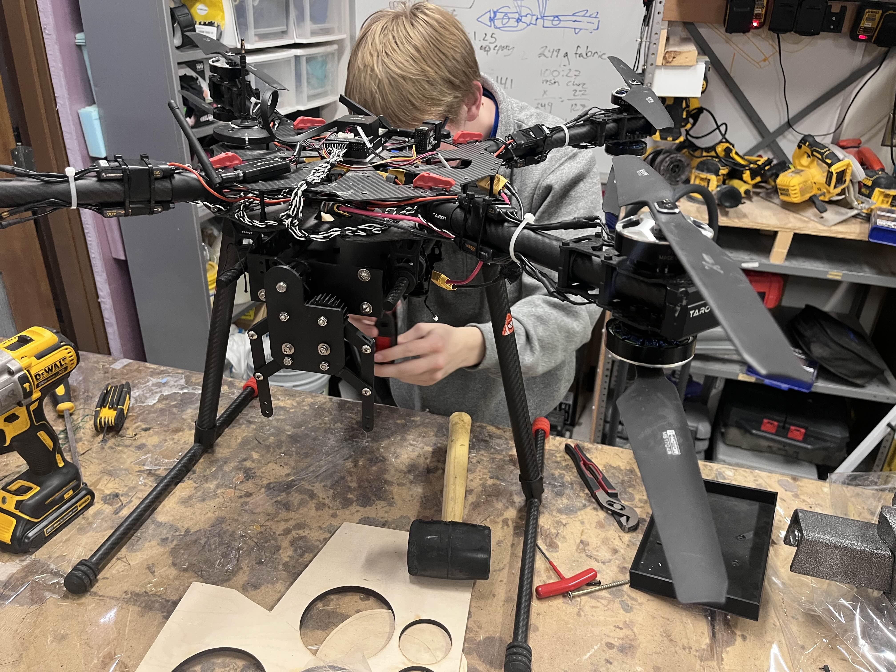
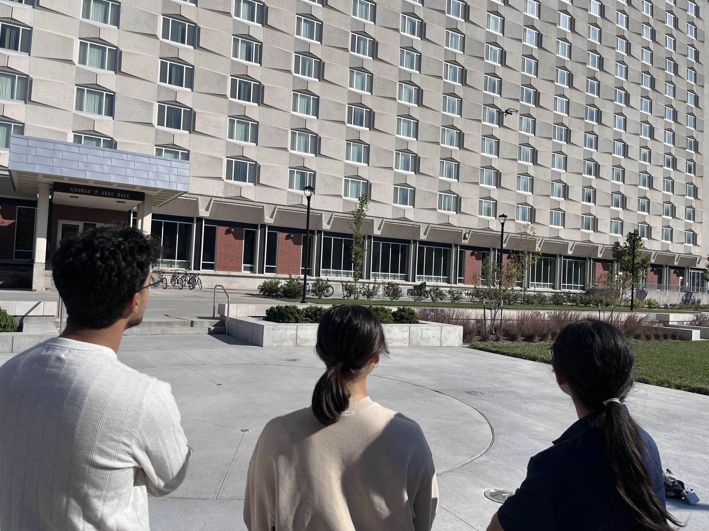

# UAV Avionics & Systems Integration

**Avionics and system-integration work on autonomous UAVs at the University of Nebraska–Lincoln.**

I spent most of my time on avionics and system integration: flight controllers, sensors, RF communications, motor controllers, onboard computing, payload electronics, and the electrical interfaces that connect them. I eventually served as **Avionics Lead**, coordinating work across avionics, embedded software, propulsion, payload, flight controls, autonomous navigation, and airframe teams.

The biggest thing UAV taught me is that **getting an individual component working is only part of the problem — everything eventually has to work together on the aircraft.** A sensor can work perfectly on the bench and still cause problems once installed. A flight-controller fault can look like software and turn out to be electrical. A radio can work on its own and behave differently once integrated. Learning to troubleshoot across those boundaries was the part I enjoyed most.

> [!NOTE]
> This repository contains only material I'm comfortable sharing publicly. Team-owned source code, detailed schematics, CAD files, configuration files, and other non-public technical material are intentionally excluded.

---

## Highlights

- **Avionics Lead** for a team of roughly 20, coordinating across avionics, embedded software, propulsion, payload, flight controls, autonomous navigation, and airframe.
- End-to-end avionics: **flight-controller integration, GPS/IMU/range sensing, RF & telemetry, motor-controller / propulsion interfaces,** and **NVIDIA Jetson Orin** onboard computing.
- **Hardware bring-up, assembly, rework, and electrical troubleshooting** — including faults that cross the hardware/software boundary.
- Multi-stage validation: **bench → hardware-in-the-loop → ground test → flight test.**
- I like owning **interfaces and system integration**, not just individual boards.

---

## System-Level Avionics

At a high level, the aircraft combined sensing, flight control, communications, propulsion, payload electronics, and onboard computing. What interested me most were the **interfaces** between these systems: where power came from, what information moved between devices, how they communicated, and how a failure in one subsystem could surface somewhere else.

```text
       GPS / IMU / Range Sensors
                 |
                 v
          Flight Controller
         /       |        \
        /        |         \
  Telemetry   Propulsion   Payload
        \        |         /
         \       |        /
          Onboard Computing
             Jetson Orin
                 |
                 v
          Complete Aircraft
```

> This is a **generalized representation**, not an actual aircraft wiring diagram.

---

## From Bench to Flight

### Assembly & Rework



*Hands-on electronics assembly and rework during UAV development.*

A lot of avionics work comes down to electrical-engineering fundamentals: making good connections, checking solder joints, confirming power, inspecting assemblies, and physically measuring signals. That reinforced a habit I still use today — **before assuming a complicated failure, verify the fundamentals:**

- Is the device receiving the correct voltage?
- Is the expected ground reference present?
- Is the connector pinned correctly?
- Is the communication signal physically present?
- Is there visible damage or an assembly problem?
- What changed between the working bench setup and the integrated aircraft?

Those questions sound simple, but they eliminate a lot of failure modes before deeper troubleshooting.

### Board Inspection & Debugging



*Inspecting UAV electronics during bench-level troubleshooting.*

Visual inspection and bench testing caught problems before hardware reached the complete aircraft — component placement, soldering, connectors, wiring, continuity, power, or communication signals. One of the most useful lessons: **the place where a failure becomes visible isn't necessarily where it originates.** My general process:

1. Understand what the system is supposed to do.
2. Measure what it is actually doing.
3. Narrow the problem to a subsystem or interface.
4. Form a hypothesis from the measurements.
5. Test the hypothesis.
6. Verify the correction.
7. Retest it as part of the complete system.

That same process later carried into custom PCB bring-up and embedded-hardware projects.

### RF, Power & Payload Integration



*Bench integration of communications hardware, power, wiring, and payload electronics.*

Avionics involved far more than the flight controller. Communication hardware, cameras, sensors, batteries, flight electronics, payload systems, and onboard computing each introduced different electrical and physical requirements, which forced me to think past whether a single component worked:

- Where does this device get power, and at what voltage and current?
- How does it communicate with the rest of the aircraft?
- Which subsystem depends on its output?
- How will it mount, and can it still be accessed once assembled?
- How will we troubleshoot it if it stops working?

This is one of the experiences that pushed me toward **system-level electrical engineering** — understanding not just the circuit, but why it exists and how it affects the whole machine.

### Flight Controller & Ground Systems



*Working with aircraft telemetry and ground-control software.*

The flight controller sat near the center of avionics integration, with sensors, telemetry, propulsion interfaces, and onboard systems all interacting with it. That made troubleshooting interesting, because the line between hardware and configuration/software wasn't always obvious: a sensor could have valid power but incorrect configuration, and an interface could be electrically fine while using the wrong settings. Working in the flight-control and ground-station environment made me much more comfortable **debugging across the hardware/software boundary** instead of treating them as separate worlds.

### Integrating Everything Into the Aircraft



*Physical integration work on a multirotor UAV.*

This was the biggest difference between UAV and a typical electronics assignment: the electronics eventually had to fit and operate inside a real aircraft. Electrical decisions interacted with propulsion, payload, mechanical mounting, communications, flight-control requirements, onboard computing, weight, available space, connector accessibility, power distribution, and maintainability.

That meant the technically best solution for one subsystem wasn't always best for the aircraft. Sometimes a design had to change because it made installation harder, created problems for another team, or increased integration risk — which gave me a much better appreciation for **engineering tradeoffs.**

### Flight Testing



*Taking avionics work out of the lab and validating the complete aircraft.*

Flight testing was where the whole system had to prove itself. The question was no longer whether a board, sensor, or radio worked — it was whether **the aircraft** worked. A problem in flight could come from power, electronics, sensor behavior, flight-controller configuration, RF, propulsion, embedded software, autonomous navigation, or mechanical integration. Working through those possibilities systematically was one of the most valuable skills UAV gave me.

---

## Testing Philosophy

UAV taught me that testing should happen at several levels, and that **finding a problem earlier is almost always cheaper than finding it during a flight test.** A component working on its own wasn't enough; the interfaces between components had to work too:

1. Verify the component or device.
2. Verify power and electrical interfaces.
3. Verify communication with the flight controller or onboard computer.
4. Verify the subsystem.
5. Run hardware-in-the-loop or controlled system tests.
6. Ground-test the integrated aircraft.
7. Validate the complete aircraft in flight.

---

## Leading the Avionics Team

As Avionics Lead working with roughly 20 people, I learned that **I didn't need to be the person who knew the most about every sensor, firmware module, RF link, or motor controller** — I needed to understand the interfaces well enough to help the different parts of the team work together. Avionics naturally crossed disciplines: an avionics decision could affect propulsion, a mechanical change could affect sensor placement, and a payload requirement could touch power, communications, mounting, and computing at once. Communication between teams mattered as much as the electronics.

When technical disagreements came up, I tried to bring the discussion back to concrete engineering constraints:

- Does it meet the requirements, and is it reliable?
- How hard is it to integrate, test, and debug?
- What does it cost in time and money?
- Does it create problems for another subsystem?
- Does it raise or lower overall project risk?

That focus became more important as competitions and deadlines approached.

---

## Why This Project Is in My Portfolio

My other projects show individual technical areas — custom PCB design and bring-up, FPGA/VHDL development, digital signal processing, mixed-signal embedded systems, and autonomous mobile robotics. **UAV is different.** It's where I learned what happens when electronics, communications, software, sensors, actuators, and mechanical systems all have to work together inside a real machine.

UAV exposed me to the full path between a sensor collecting information and an aircraft physically responding to it — and showed me why the **interfaces** between electrical hardware, embedded software, RF, propulsion, sensors, and mechanical systems matter. That system-level engineering is the kind of work I want to keep building on.

---

## Areas of Experience

**Avionics** — flight-controller integration · GPS/IMU sensors · range sensing · embedded electronics · motor-controller interfaces

**Communications** — RF links · telemetry · ground-control interfaces · communication troubleshooting

**Computing** — NVIDIA Jetson Orin · autonomous-navigation hardware · hardware/software interfaces

**Testing** — bench testing · hardware bring-up · hardware-in-the-loop · system validation · ground testing · flight testing · fault isolation

**Systems Engineering** — interface coordination · requirements discussions · multidisciplinary design decisions · integration troubleshooting · technical tradeoffs

**Leadership** — avionics team leadership · cross-disciplinary coordination · technical decision-making · competition preparation

---

## Public Material Only

The UAV program was a team effort spanning electrical hardware, software, mechanical design, flight controls, and autonomous systems. I intentionally **do not** publish team-owned source code, detailed electrical schematics, PCB design files, internal wiring diagrams, CAD files, aircraft configuration files, or any technical documentation I can't clearly treat as public. This repository documents my experience with **avionics integration, testing, debugging, and system-level engineering** — it is not a reproduction of the team's aircraft design.
